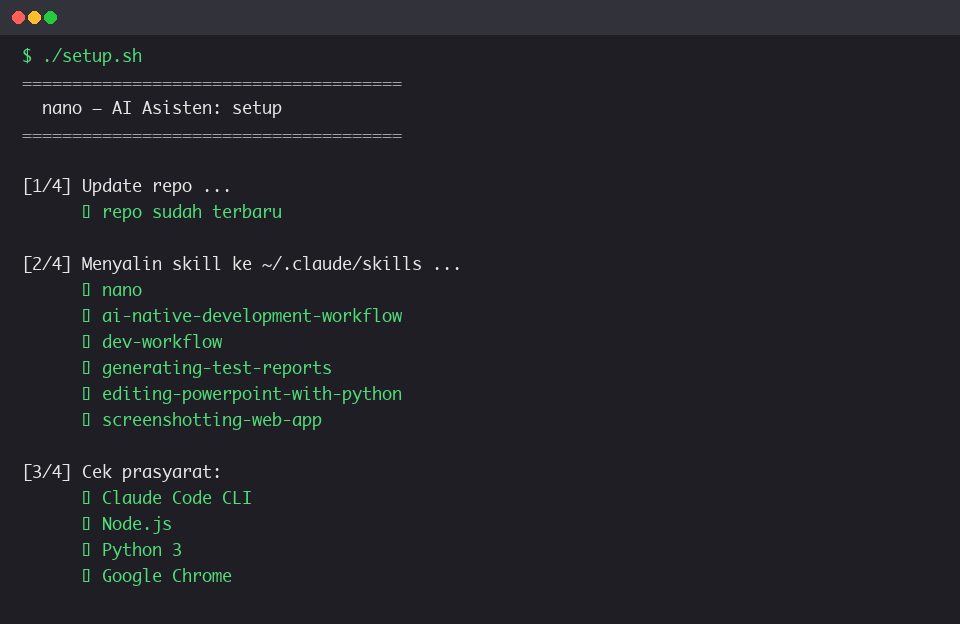
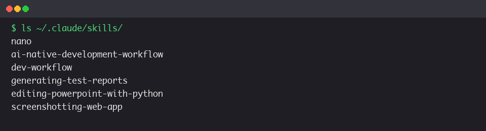
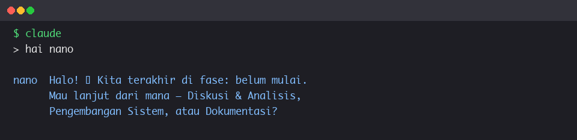

# Panduan Instalasi nano

Panduan lengkap memasang **nano** — AI Asisten untuk Manajemen Proyek — di perangkat lain,
dari nol sampai bisa dipakai. Cocok untuk pemula.

---

## 1. Apa itu nano?

nano adalah asisten kerja berbasis AI (skill Claude Code) yang membantu tim menyelesaikan
siklus pengembangan sistem secara utuh: **Diskusi & Analisis → Pengembangan Sistem →
Dokumentasi**, dengan Pilar (design system UII), memori antar-sesi, dan kontrol manusia.

nano **bukan aplikasi terpisah** — ia bekerja di dalam **Claude Code**.

---

## 2. Pasang Claude Code (wajib, sekali saja)

nano adalah skill yang dibaca oleh Claude Code. Jadi langkah pertama: pasang Claude Code.

### 2.1 Install Claude Code

```bash
# macOS / Linux — via npm
npm install -g @anthropic-ai/claude-code

# atau installer resmi
curl -fsSL https://claude.ai/install.sh | bash
```

> **Windows:** gunakan WSL, atau ikuti panduan resmi di
> https://docs.anthropic.com/claude-code.

### 2.2 Login

```bash
claude
```

Saat pertama dijalankan, Claude Code meminta login (akun Anthropic). Ikuti sampai masuk.

---

## 3. Prasyarat lainnya

### 3.1 Wajib

| Kebutuhan | Cara pasang (macOS) | Catatan |
|---|---|---|
| Git | `brew install git` (biasanya sudah ada) | untuk clone & update |
| Node.js | `brew install node` (atau nvm) | untuk Angular 18 (**≥ 18.19 / 20.11**) & Playwright |
| Python 3 | sudah ada, atau `brew install python` | untuk script |
| Google Chrome | unduh dari google.com/chrome | untuk screenshot & PDF |
| PHP ≥ 8.3 | `brew install php` | **hanya aplikasi demo** — backend Laravel |
| Composer | `brew install composer` | **hanya aplikasi demo** — dependency backend |

> **Catatan:** PHP + Composer hanya dibutuhkan untuk menjalankan **aplikasi demo**
> (`backend/`). Skill nano sendiri cukup dengan Claude Code + Node.js.
>
> **Windows/Linux:** pakai package manager masing-masing (scoop/choco untuk Windows; apt/dnf
> untuk Linux). Perintah `setup.sh` berbasis bash — di Windows jalankan lewat WSL/Git Bash.

### 3.2 Opsional (untuk fitur penuh)

| Kebutuhan | Cara pasang | Untuk fitur |
|---|---|---|
| Figma MCP | konfigurasi di Claude Code settings + login Figma | design-to-code / code-to-design |
| Superpowers skills | plugin Claude Code | brainstorming, TDD, dst. |
| Context7 (opsional) | `/plugin marketplace add upstash/context7` (di Claude Code) | doc library terkini |
| ngrok (opsional) | `brew install ngrok` + authtoken | publish prototype (URL publik) |
| Confluence (opsional) | skill `generating-confluence-docs` + `.env.confluence` | publish dokumen ke Confluence |
| Playwright + Chromium | `npm i -D @playwright/test && npx playwright install chromium` | automated test |
| python-pptx + Pillow | `pip3 install python-pptx pillow` | deck + diagram |
| Akses PILAR | https://www.figma.com/design/AYHhj3V2tSnZleViFsIjEx/PILAR-DESIGN-SYSTEM | sumber desain resmi |

> Tanpa yang "opsional", nano tetap bisa dipakai untuk PRD, FSD, BPMN, dan penyusunan dokumen.

---

## 4. Langkah instalasi nano

### Langkah 1 — Clone repo

```bash
git clone https://github.com/dhenta312/hackathon-appraisal.git
cd hackathon-appraisal
```

### Langkah 2 — Jalankan setup

```bash
./setup.sh
```

Script ini otomatis: `git pull` → menyalin semua skill ke `~/.claude/skills/` → cek prasyarat.



### Langkah 3 — Restart Claude Code

Tutup terminal/session Claude Code, lalu buka lagi. Claude Code mengenali skill baru setelah
dijalankan ulang.

### Langkah 4 — Verifikasi

```bash
ls ~/.claude/skills/
```



Pastikan folder `nano` (dan skill lain) muncul di daftar.

### Langkah 5 — Coba

```bash
claude
> hai nano
```



nano akan menjawab dan menawarkan tiga pekerjaan.

---

## 5. Memulai proyek baru dengan nano

1. Buat folder proyek baru.

2. Salin template memori (sekali saja per proyek):

   ```bash
   mkdir -p proyek-baru/docs/nano
   cp hackathon-appraisal/docs/nano/state.md proyek-baru/docs/nano/state.md
   ```

3. Buka Claude Code di proyek baru:

   ```bash
   cd proyek-baru
   claude
   ```

4. Panggil nano:

   ```
   > hai nano
   ```

   nano membaca memori (`docs/nano/state.md`) lalu menawarkan: **Diskusi & Analisis**,
   **Pengembangan Sistem**, atau **Dokumentasi**.

---

## 6. Cara pakai

Tiga pekerjaan nano:

| Pekerjaan | Fungsi |
|---|---|
| **Diskusi & Analisis** | catatan rapat → PRD + FSD + BPMN |
| **Pengembangan Sistem** | design Figma + document spec + prototype (Angular + Laravel) |
| **Dokumentasi** | automated test + report + user manual |

---

## 7. Cara update ke versi terbaru

```bash
cd <folder-repo>
./setup.sh
```

Satu perintah cukup — `setup.sh` otomatis `git pull` dulu, lalu menyalin ulang skill.

---

## 8. Troubleshooting

| Masalah | Penyebab | Solusi |
|---|---|---|
| `ERROR: Unknown skill: nano` | skill belum terinstall / Claude Code belum di-restart | jalankan `./setup.sh`, lalu restart Claude Code |
| `Unknown skill: superpowers:...` | plugin Superpowers belum terpasang | pasang plugin Superpowers |
| `Unknown skill: figma:...` | Figma MCP belum dikonfigurasi | pasang Figma MCP + login Figma |
| `./setup.sh` gagal (bukan repo git) | repo diunduh sebagai zip | clone via `git clone` (bukan download zip) |
| Skill terinstall tapi tidak terbaca | Claude Code belum restart | tutup & buka lagi Claude Code |

### Cek cepat bila masih bermasalah

```bash
ls ~/.claude/skills/nano/SKILL.md     # file skill ada?
head -4 ~/.claude/skills/nano/SKILL.md   # name: nano cocok?
```

---

## 9. Catatan

- **Memori (`docs/nano/state.md`) bersifat per-proyek.** Untuk proyek baru, salin template-nya
  (lihat bagian 5), atau biarkan nano membuatkannya di run pertama.
- **nano butuh Claude Code** — dia "otak" yang dibaca Claude Code, bukan program yang diklik.
