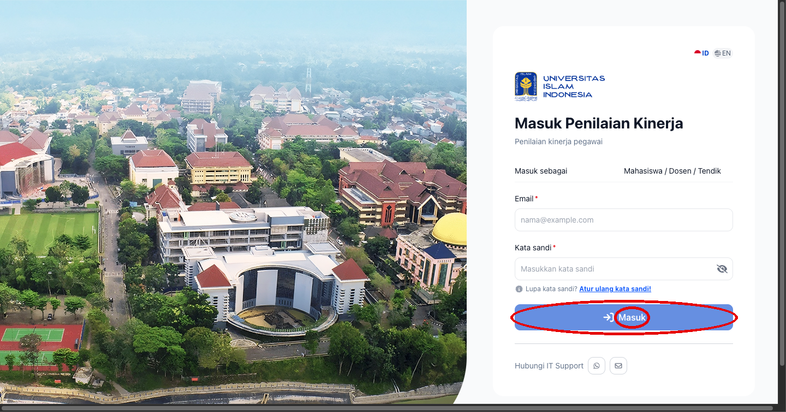
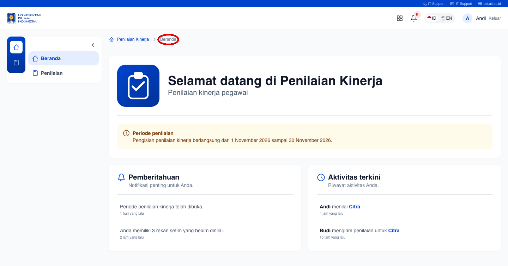
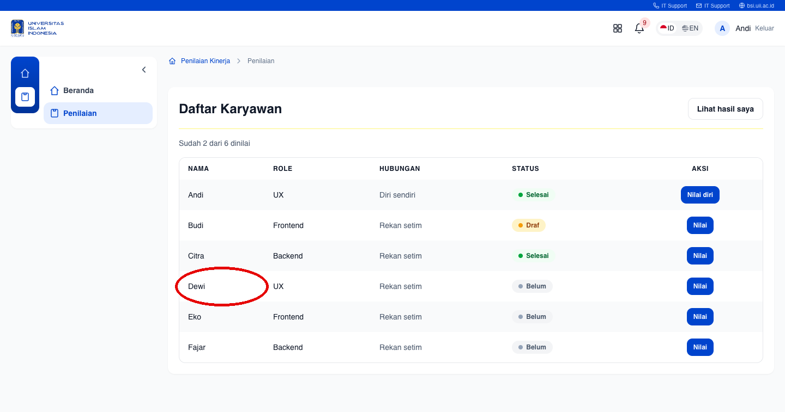
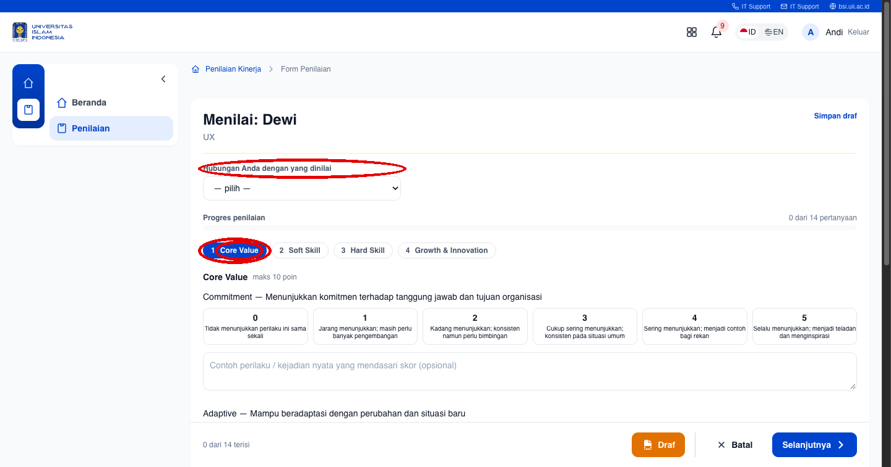
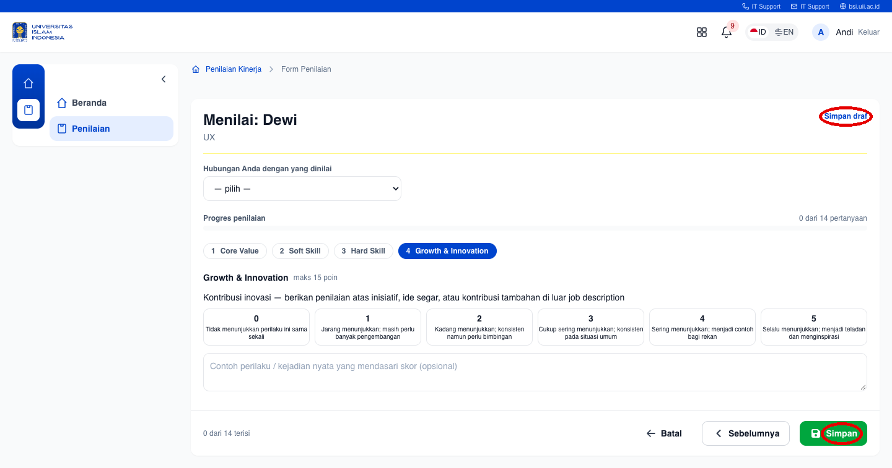
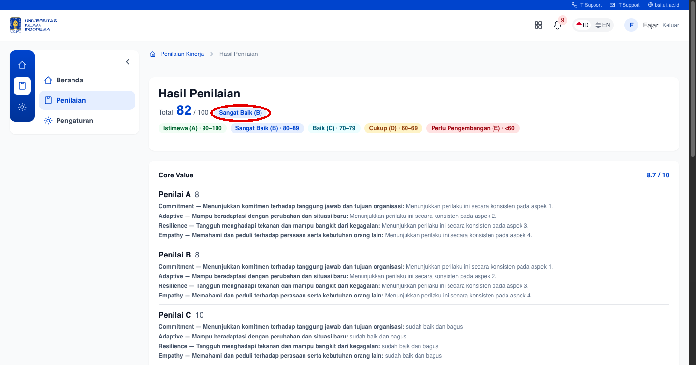
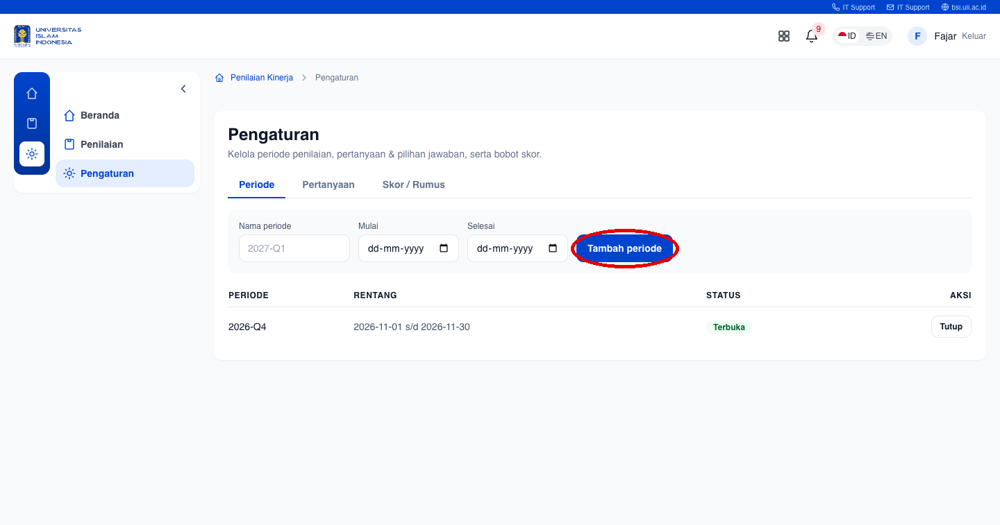

# Document Spec: Penilaian Kinerja

## Feature Description

Aplikasi **Penilaian Kinerja** adalah aplikasi web untuk mengelola penilaian kinerja pegawai
Universitas Islam Indonesia (UII), menggantikan proses berbasis Google Form + rekap manual.
Aplikasi menyediakan **alur menilai yang ringan** (role auto-load, alasan per komponen, save
draft & resume, progres), **deteksi pengisian asal** (skor seragam / rata-kanan / alasan copas),
dan **skor yang transparan** (rumus terbuka, rincian per komponen, kontribusi penilai anonim,
grade band A–E, presensi sebagai data terpisah), serta **pengaturan mandiri** oleh admin
(periode, pertanyaan, pilihan jawaban, bobot).

## Specification Details

- **Frontend:** Angular 18 (standalone components + signals) dengan Tailwind CSS dan design token **PILAR (UII)**.
- **Backend:** REST API Laravel, basis data SQLite (schema MySQL-compatible), auth Sanctum token.
- **Form penilaian:** multi-step 4 langkah (stepper PILAR): **Core Value → Soft Skill → Hard Skill → Growth & Innovation**.
- **Hubungan penilaian:** Diri sendiri / Atasan langsung / Rekan sejawat / Bawahan / Lainnya.
- **Skala:** 0–5 dengan deskripsi indikator perilaku; alasan per pertanyaan (opsional).
- **Deteksi pengisian asal:** skor seragam, semua-maksimal, dan alasan copas → banner peringatan + flag di data.
- **Skor:** total 0–100 = Core Value (10) + Soft Skill (25) + Hard Skill (30) + Growth & Innovation (15) + Presensi (20).
- **Grade band:** Istimewa (A) 90–100 · Sangat Baik (B) 80–89 · Baik (C) 70–79 · Cukup (D) 60–69 · Perlu Pengembangan (E) <60.
- **Anonim:** kontribusi tiap penilai ditampilkan sebagai "Penilai A/B".
- **Banding:** pegawai dapat mengajukan peninjauan ulang hasil.
- **Responsif:** layout menyesuaikan desktop.

## UI Design Specifications Flow

| No | UI Design | Specifications | Flow |
|----|-----------|----------------|------|
| 1 | **Login**  | • Form email + password. • Tombol **Masuk** (primary). • Auth Sanctum token; akun seeded. | 1. Buka aplikasi di browser. 2. Masukkan email & password. 3. Klik **Masuk** → masuk ke Beranda. |
| 2 | **Beranda**  | • Sidebar navigasi (Beranda, Penilaian). • Info periode aktif & aktivitas. | 1. Setelah login, membaca halaman Beranda. 2. Lanjut ke menu **Penilaian** untuk menilai. |
| 3 | **Tim Saya**  | • Daftar rekan setim + status (Belum / Draf / Selesai). • Progres "sudah X dari N". • Klik nama rekan untuk membuka form. | 1. Buka menu **Penilaian**. 2. Lihat status & progres tiap rekan. 3. Klik nama rekan (mis. Dewi). |
| 4 | **Form Penilaian — Langkah 1 (Core Value)**  | • Pilih **Hubungan Anda** (dropdown). • Step pills 1–4 (komponen). • Skala 0–5 dengan deskripsi perilaku. • Alasan per pertanyaan (opsional). • Stepper: **Draf / Batal / Selanjutnya**. | 1. Pilih hubungan dengan yang dinilai. 2. Isi skor 0–5 tiap pertanyaan. 3. Isi contoh perilaku (opsional). 4. Klik **Selanjutnya** → langkah berikutnya. |
| 5 | **Form Penilaian — Langkah Terakhir**  | • Stepper langkah terakhir: **Batal / Sebelumnya / Simpan** (hijau). • Tombol **Simpan draf** (pojok kanan atas) menyimpan tanpa mengirim. | 1. Sampai langkah terakhir. 2. Klik **Simpan** untuk mengirim (skor terhitung), atau **Simpan draf** untuk dilanjutkan nanti. |
| 6 | **Hasil Penilaian**  | • **Total 0–100** + badge grade band (mis. "Sangat Baik (B)"). • Rincian per komponen + bobot. • Kontribusi **Penilai A/B** (anonim) + alasan. • Presensi sebagai baris data terpisah. | 1. Buka **Hasil Penilaian** (admin: pilih orang; pegawai: lihat sendiri). 2. Baca total, grade band, rincian per komponen. 3. Lihat kontribusi tiap penilai (anonim). |
| 7 | **Pengaturan (Admin)**  | • Tab **Periode / Pertanyaan / Skor / Rumus**. • Buka/tutup periode penilaian. • Kelola pertanyaan + pilihan jawaban + bobot. • Tombol **Tambah periode**. | 1. Login sebagai admin (Fajar). 2. Buka menu **Pengaturan**. 3. Kelola periode, pertanyaan, dan bobot. |
