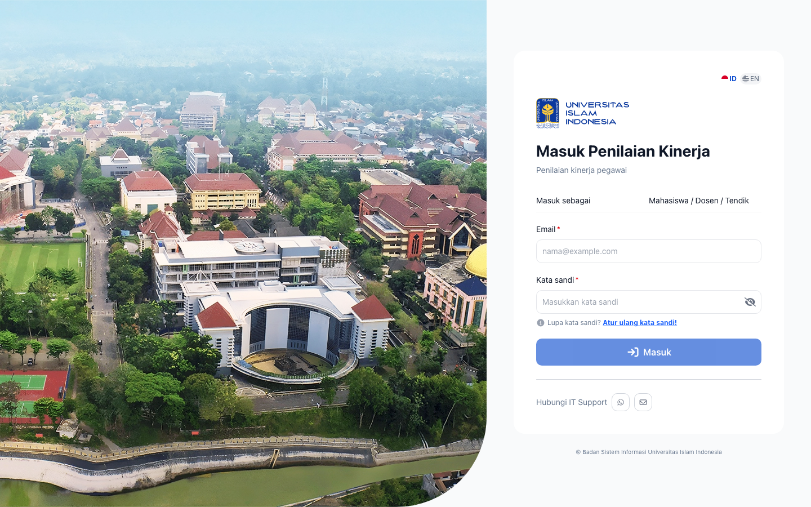
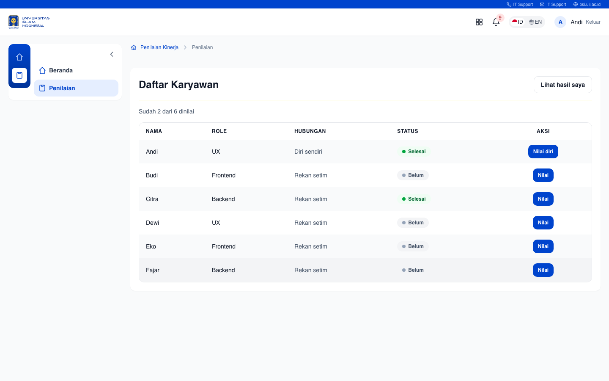
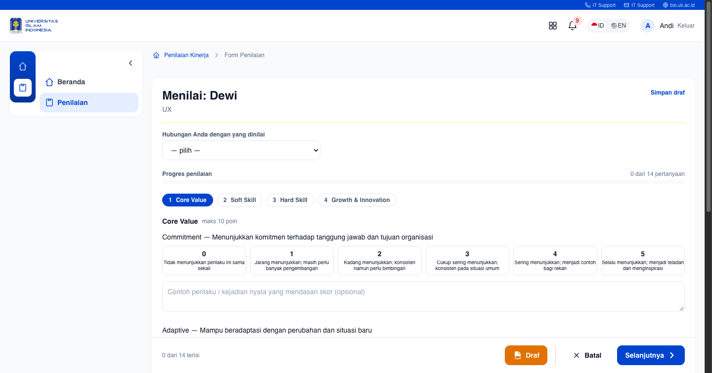
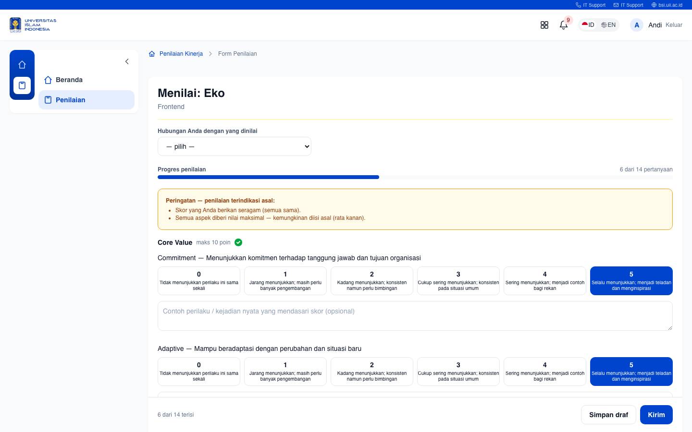
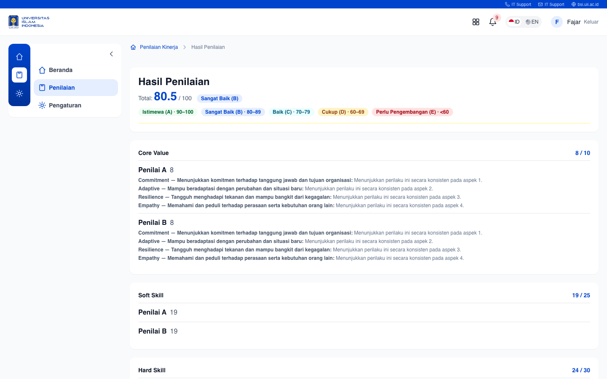
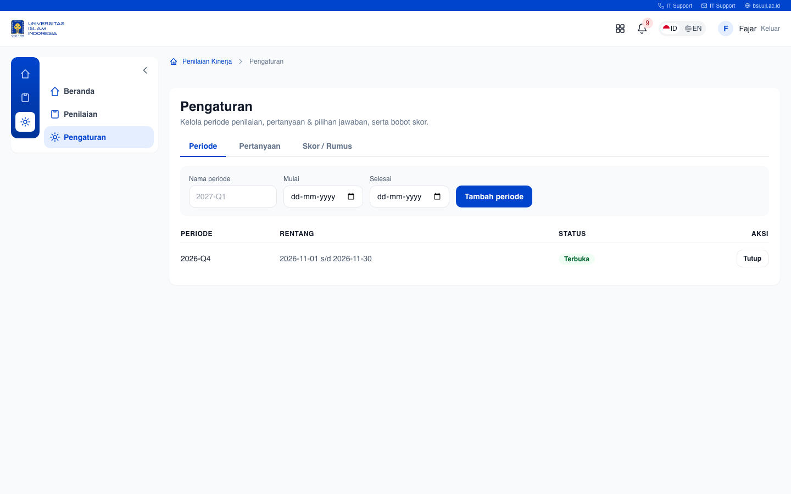

# Panduan Pengguna — Platform Penilaian Kinerja

Panduan untuk **pegawai (penilai)** dan **admin/HR** dalam menggunakan sistem penilaian
kinerja pegawai.

---

## 1. Tentang Sistem

Platform Penilaian Kinerja menggantikan penilaian berbasis Google Form + rekap manual.
Tujuannya: **alur menilai yang ringan** dan **skor yang transparan**.

- Skor maksimum **100**, terdiri dari 5 komponen: Core Value (10), Soft Skill (25),
  Hard Skill (30), Growth & Innovation (15), Kehadiran & Kedisiplinan (20).
- Kehadiran ditarik dari data absensi (bukan dinilai oleh rekan).
- Skor final = rata-rata dari semua penilai yang sudah mengirim.

## 2. Akses & Login

1. Buka aplikasi di browser (`http://localhost:4200`).
2. Masukkan **email** dan **password**.
3. Klik **Masuk**.

### Akun demo (password semua: `password`)

| Nama | Email | Peran |
|---|---|---|
| Andi | andi@example.com | Penilai |
| Budi | budi@example.com | Penilai |
| Citra | citra@example.com | Pegawai |
| Dewi | dewi@example.com | Pegawai |
| Eko | eko@example.com | Pegawai |
| Fajar | fajar@example.com | Admin/HR |

## 3. Peran Pengguna

| Peran | Yang bisa dilakukan |
|---|---|
| **Pegawai (penilai)** | Menilai siapa saja (360°), melihat hasil **diri sendiri** |
| **Admin/HR** | Melihat hasil **semua pegawai**, mengatur periode, pertanyaan, & bobot |

## 4. Panduan Penilai — Alur Menilai (360°)

### 4.1 Melihat Tim & Progres

Setelah login, masuk ke halaman **Tim saya**: daftar semua pegawai + status tiap orang
(Belum / Draf / Selesai) + progres "sudah X dari N dinilai".

### 4.2 Mengisi Form Penilaian (multi-step)

Klik nama pegawai → form penilaian terbuka **otomatis sesuai role** orang tersebut (tidak perlu
memilih role manual). Form terdiri dari beberapa langkah (komponen):

1. **Hubungan Anda** — pilih Diri sendiri / Atasan langsung / Rekan sejawat / Bawahan / Lainnya.
2. **Langkah 1–4** — Core Value → Soft Skill → Hard Skill → Growth & Innovation.
3. Tiap pertanyaan dinilai skala **0–5** dengan deskripsi perilaku.
4. Isi **contoh perilaku/kejadian nyata** yang mendasari skor (opsional, satu per pertanyaan).

Navigasi pakai tombol di bawah: **Draf** (simpan), **Batal** (keluar), **Sebelumnya**,
**Selanjutnya**, **Simpan** (di langkah terakhir = kirim).

### 4.3 Simpan Draf & Lanjut Nanti

- Klik **Draf** (langkah 1) atau link **Simpan draf** (pojok kanan atas) untuk menyimpan
  tanpa mengirim.
- Isian tersimpan — bisa dibuka kembali kapan saja dan dilanjutkan.

### 4.4 Kirim Penilaian

- Sampai di **langkah terakhir**, klik **Simpan** (hijau).
- Bila terdeteksi indikasi pengisian asal, muncul konfirmasi (lihat bagian 5).

## 5. Peringatan Deteksi Pengisian Asal

Sistem mendeteksi pola pengisian yang tidak wajar dan menampilkan **banner peringatan**:

- **Skor seragam** — semua nilai sama.
- **Semua maksimal** — semua nilai 5 (rata-kanan).
- **Alasan copas** — contoh perilaku yang sama persis antar aspek.

Saat mengirim dengan indikasi ini, muncul dialog konfirmasi: **"Periksa ulang"** atau
**"Tetap kirim"**. Peringatan juga dicatat sebagai *flag* di data.

## 6. Dashboard Hasil — Skor Transparan

### 6.1 Total & Rincian per Komponen

- **Total 0–100** + rincian tiap komponen beserta bobotnya.
- Rumus skor **ditampilkan** (bukan kotak hitam): `skor komponen = rata-rata nilai ÷ 5 × bobot`.

### 6.2 Grade Band (Predikat)

| Predikat | Rentang |
|---|---|
| Istimewa (A) | 90–100 |
| Sangat Baik (B) | 80–89 |
| Baik (C) | 70–79 |
| Cukup (D) | 60–69 |
| Perlu Pengembangan (E) | < 60 |

### 6.3 Kontribusi Penilai (Anonim)

Tiap komponen menampilkan kontribusi masing-masing penilai secara **anonim**
("Penilai A", "Penilai B") lengkap dengan alasannya.

### 6.4 Kehadiran

Kehadiran ditampilkan sebagai **baris data terpisah** (mis. 18/20), bukan "dinilai" rekan.

## 7. Penilaian 360° & Hubungan

Sistem mendukung penilaian **360°**: menilai atasan, rekan, bawahan, diri sendiri, atau
lintas tim. Hubungan dipilih di awal form (bagian 4.2).

## 8. Ajukan Banding

Pegawai yang keberatan dengan hasil dapat **mengajukan banding** (peninjauan ulang) dari
dashboard hasilnya.

## 9. Panduan Admin (HR)

### 9.1 Periode Penilaian

Buka/tutup periode penilaian dari halaman **Pengaturan**. Periode terbuka menentukan
perilaku pengisian.

### 9.2 Kelola Pertanyaan & Pilihan Jawaban

Tambahkan/ubah pertanyaan, pilihan jawaban, dan skala — **tanpa perlu membuat form baru**.

### 9.3 Bobot Komponen

Atur bobot tiap komponen (Core Value, Soft Skill, dst.) sesuai kebijakan.

### 9.4 Lihat Hasil Semua Pegawai

Admin bisa membuka hasil siapa pun dari **Tim saya** (tombol **Hasil**), bukan hanya
hasil sendiri.

## 10. FAQ

**Q: Kenapa skor saya belum muncul?**
A: Skor dihitung hanya dari penilaian berstatus **terkirim**. Draf tidak memengaruhi skor.

**Q: Kenapa form-nya beda antar rekan?**
A: Form mengikuti **role** rekan yang dinilai (Hard Skill berbeda per role). Ini otomatis.

**Q: Bisakah menilai tanpa menyelesaikan semua langkah?**
A: Ya — simpan sebagai draf, lanjutkan kapan saja.

**Q: Apa bedanya Draf dan Simpan?**
A: **Draf** = simpan sementara (belum dihitung). **Simpan** (langkah terakhir) = kirim & hitung.
